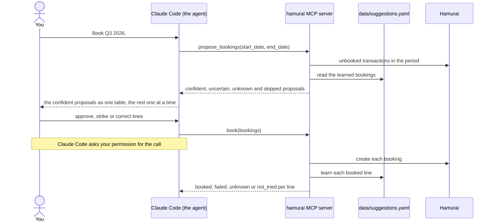

<p align="center"></p>

# Hamurai

**Hamurai** is a fictional online accounting application, of the kind a freelancer uses to keep their books: the business bank account's transactions come in automatically, and each one has to be booked onto a category (the ledger account) with a VAT code. Receipts are uploaded to it and linked to the expenses they prove. The VAT return is built from those bookings, so every quarter each transaction has to be booked.

This project is an [MCP](https://modelcontextprotocol.io) server that does that bookkeeping in Hamurai through its web app's API. It gives an AI agent the tools to:
- propose a category and VAT code for each unbooked transaction, from how the same counterparty was booked before;
- split a credit card collection into its purchases;
- link uploaded receipts to their expenses.

[Claude Code](https://claude.com/claude-code) is the agent and the interface. The agent books only what you approve, and learns from each booking.

## Motivation

The motivation for this project is twofold:
1. To take the quarterly chore of booking every bank transaction, card purchase and receipt off my hands, while keeping the final say over each booking.
2. To show how I work with Claude Code: every piece of work starts as a design and a plan, and lands as one reviewable commit per task.

## Name

The name **Hamurai**, for both the accounting application and this project, is a nod to Hamurai, the samurai dressed in ham, one of the parasites that pose as old friends in the episode "Total Rickall" of the [Rick and Morty](https://www.imdb.com/title/tt2861424/) series.

## Installation

The project's commands run through [Task](https://taskfile.dev) and [uv](https://docs.astral.sh/uv/), on Python 3.14 (pinned in `.python-version`; uv installs it if needed). With both installed, install the project and its git hooks with:

```bash
task setup
```

Then copy `.env.example` to `.env` and fill it in:

- `HAMURAI_BASE_URL`: the web app's address, the host of its `/api/v2/...` requests in DevTools → Network, as `https://<host>`.
- `HAMURAI_APP_HEADER`: the web app's own header, sent with each of those requests, as `name: value`. Bookings are refused without it.
- `HAMURAI_COOKIE`: paste the value of Hamurai's `Authorization` cookie after the `Authorization=` that is already there. In the browser, open Hamurai, then DevTools → Application → Cookies → the host in `HAMURAI_BASE_URL`, and copy the value of `Authorization`.
- `HAMURAI_ADMINISTRATION_ID` and `HAMURAI_JOURNAL_ID`: in DevTools → Network, open any `/api/v2/...` request. Its URL holds both numbers: `/administrations/<administration id>/...?journalId=<journal id>`.

`.env` and `data/` are git-ignored: the cookie and the learned bookings never go into the repository.

`task check` runs every check: lint, type check and tests. `task --list` shows the rest (`format`, `lint`, `typecheck`, `test`, `pre-commit`). The git hooks run the same checks: pre-commit over the staged files, pre-push the whole of `task check`. CI runs `task check` on every pull request and every push to `main`, except for changes to Markdown and `docs/` only. No test talks to Hamurai: they run against an in-memory fake with invented data, so CI needs no secrets.

## How booking a quarter works

The agent proposes, you decide, and the server books. Claude Code asks your permission for every `book` call, and every booking you approve is learned for next time.



## Usage

Start Claude Code in this directory. It picks up the `hamurai` server from `.mcp.json`, and the agent gets these tools:

| Tool | Writes to | What it does |
|---|---|---|
| `list_categories`, `list_vat_codes` | nothing | Hamurai's categories (ID, code, name) and VAT codes (ID, description). |
| `list_suggestions(group_by, text, category_id, limit)` | nothing | Lists what has been learned: every counterparty once, under the pair it is proposed with, grouped by `category` (category and VAT code), `vat` or `match` (always ask, by IBAN, by name), the busiest `limit` per group. Patterns and provider IBANs come apart. |
| `propose_bookings(start_date, end_date)` | nothing | Proposes a category and VAT code for each unbooked transaction in the period, in four groups: `confident` (IBAN match), `uncertain` (name or description match), `unknown` (no match) and `skipped` (partly booked, never touched). Each proposal says why. |
| `seed_suggestions` | nothing | Reads the whole booking history and builds the suggestions in memory. Lists the counterparties booked under more than one category or VAT code. |
| `save_suggestions(resolutions)` | `data/suggestions.yaml` | Writes the seeded suggestions, with your choice for each flagged counterparty. Refuses if the file already exists. |
| `book(bookings)` | Hamurai and `data/suggestions.yaml` | Books the given lines and learns each one. The only tool that creates bookings. |
| `propose_split(statement_path)` | nothing | Reads a credit card statement (CSV), finds the unbooked collection its purchases add up to, and proposes a category and VAT code for each line: `confident` for a known merchant, `uncertain` for an *always ask* merchant or a description match, `unknown` otherwise. Lists the rows left out. |
| `book_split(transaction_id, lines)` | Hamurai and `data/suggestions.yaml` | Books the proposed collection as one booking per line, all or nothing, and learns each merchant. |
| `propose_receipts(start_date, end_date)` | nothing | Matches the unlinked receipts to the period's expenses by amount and date: `confident` pairs, `ambiguous` groups to pick from, `unmatched` receipts, and how many receipts have no amount Hamurai could read. |
| `link_receipts(links)` | Hamurai | Links the given receipts to their transactions. |
| `relearn_providers` | `data/suggestions.yaml` | Rebuilds what was learned on the payment providers' IBANs (`provider_ibans`), one entry per merchant. |
| `undo_booking(booking_id)` | Hamurai and `data/suggestions.yaml` | Deletes a booking and takes back what it taught. |

Amounts in tool output are in cents: `-1299` is € −12,99.

You talk to Claude in plain words; it picks the tools. The prompts below are examples, not commands.

### Connect

Run `/mcp` in Claude Code: `hamurai` should show as connected. If it isn't, run `uv run hamurai` in a terminal to see why (a missing variable is named, never shown).

Reconnect from `/mcp` after changing `.env` or the code.

### Seed the suggestions, once

> Seed the suggestions from the booking history.

This takes a few minutes. The summary lists the `flagged` counterparties: those booked under more than one category or VAT code. For each, tell Claude either:

- **one category and VAT code**, proposed as `confident` from then on, or
- **always ask**, for a counterparty with no single right category (your own account, the tax office). It is always proposed as `uncertain`.

> Take the one used most each time, but the current VAT rate where it changed. Always ask for my own account, the Belastingdienst and Tikkie.

`save_suggestions` then writes `data/suggestions.yaml`, which stays readable and can be edited by hand.

Seed before booking anything: `save_suggestions` never overwrites an existing file.

### Book a quarter

> Book Q3 2026.

Claude shows the confident proposals as one table to approve, then the uncertain and unknown ones one at a time.

Claude Code asks your permission for every `book` call. That prompt is your hard stop: check it, and never choose "always allow" for `book`.

| Status | Meaning |
|---|---|
| `booked` | Booked and learned. |
| `failed` | Refused, or already booked in the meantime. |
| `unknown` | No answer: ask for the proposals again. It is never booked twice. |
| `not_tried` | The session expired before this line was sent. |

When you book a counterparty differently than before, the latest choice wins.

### Split a credit card collection

Download the month's card statement as CSV, drag it into the Claude Code prompt, and ask:

> Split the card collection from this statement: ~/Desktop/statement.csv

The card's identifying details never show up in the conversation. The payment row, refunded purchases and zero rows are left out and listed. The lines must add up to one unbooked bank transaction, or nothing is booked.

For a merchant it hasn't seen, Claude picks the VAT code by location: "Geen / Vrijgesteld" outside the EU, 21% inside. Every line is booked, so correct a line rather than strike it.

`book_split` books all lines or none. To undo a split, undo each of its bookings.

### Link receipts

Upload receipts with the Hamurai app as usual, then ask:

> Link the receipts for Q3 2026.

Receipts are matched to expenses by amount and date: a bank transaction from 30 days before to 3 days after, a card purchase up to 45 days before its collection. Confident pairs come as one table, `ambiguous` ones for you to pick from. Receipts without a readable amount, which is most PDFs, are only counted.

To undo a wrong link, use the web app.

### Undo a booking

> Undo the booking for the parking garage.

`undo_booking` deletes the booking and takes back what it taught. It deletes any booking ID it gets, so check the ID in the permission prompt.

### Look through the suggestions

> Show me the suggestions by VAT code.
>
> What do you know about Spotify?

`list_suggestions` groups what has been learned by `category` (the default), `vat` or `match` (always ask, by IBAN, by name), ten per group. Ask for more when you want the rest. It writes nothing: to change a suggestion, book differently or edit `data/suggestions.yaml`.

### Add a description pattern

For transactions with neither an IBAN nor a name, such as bank fees, add a pattern to `data/suggestions.yaml`:

```yaml
patterns:
- {contains: bankkosten, category_id: 123, vat_code_id: 45}
```

A matching description is proposed as `uncertain`. Ask Claude to list the categories and VAT codes for the IDs.

### Payment providers

Providers such as Adyen and Mollie collect for many merchants under one IBAN. List those IBANs in `data/suggestions.yaml`, so their transactions are matched by merchant name instead:

```yaml
provider_ibans:
- NL00PROV0000000001
```

Then ask Claude to relearn the payment providers. When a learned IBAN suddenly shows another party's name, the proposal hints it may be a provider.

Comments in `data/suggestions.yaml` are lost when the tool saves it.

### Refresh the session

Sessions last about a day. When one expires, paste a fresh `Authorization` cookie into `.env`, reconnect from `/mcp`, and ask Claude to book any `not_tried` lines again.

## License

This project is licensed under the MIT License - see the [LICENSE](LICENSE) file for details.

## Acknowledgements

- [Rick and Morty](https://www.imdb.com/title/tt2861424/)
- [Model Context Protocol](https://modelcontextprotocol.io)
